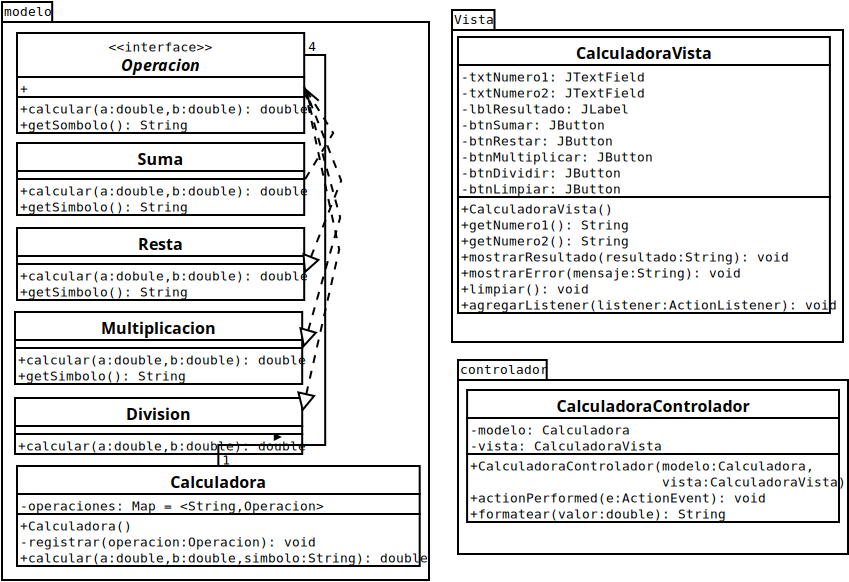

# Calculadora MVC – Java SE (stand-alone)

Aplicación de escritorio con las 4 operaciones aritméticas básicas, construida con **Java SE + Swing**, arquitectura **MVC** y **Programación Orientada a Objetos**, sin frameworks.

- **IDE:** IntelliJ IDEA Community 2025.2
- **Sistema:** Lubuntu (máquina virtual en VirtualBox)
- **Pruebas:** JUnit 4.13.2
- **Diagrama:** DIA

## Arquitectura
| Capa | Clases |
|---|---|
| Modelo | `Operacion` (interfaz), `Suma`, `Resta`, `Multiplicacion`, `Division`, `Calculadora` |
| Vista | `CalculadoraVista` (Swing) |
| Controlador | `CalculadoraControlador` |

## Diagrama de clases

## Aplicación

## Pruebas unitarias
    mvn test

Resultado: `Tests run: 21, Failures: 0, Errors: 0` – **BUILD SUCCESS**

## Ejecutar
    mvn package
    java -jar target/calculadora-mvc-1.0.jar

**Autor:** Jefferson Ibañez (JeffersonIB)
